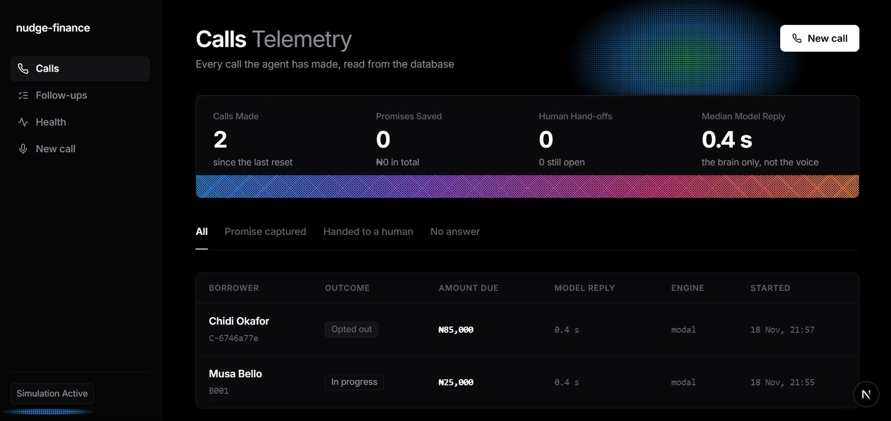
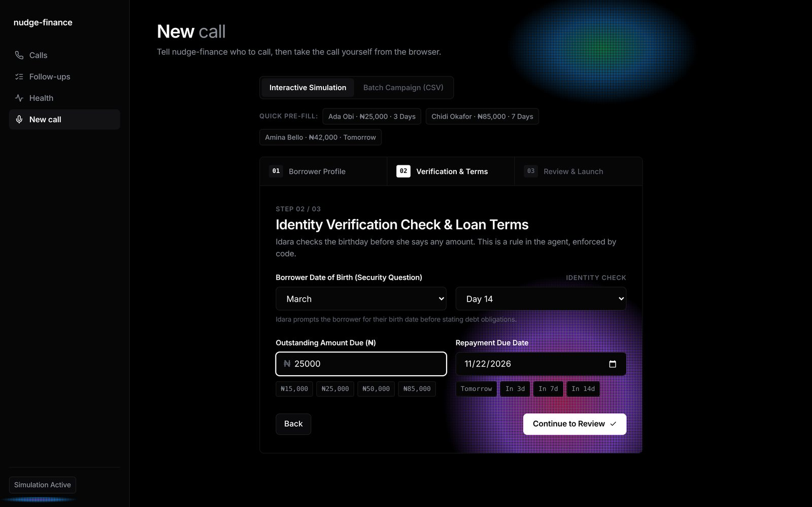
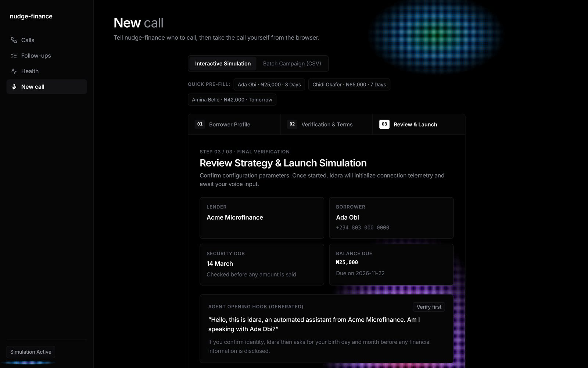
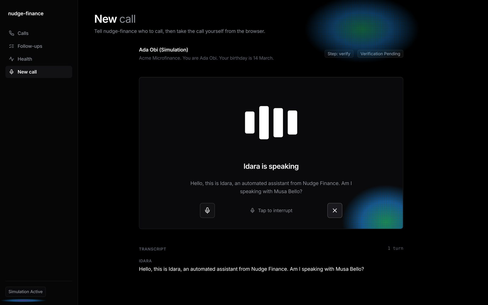
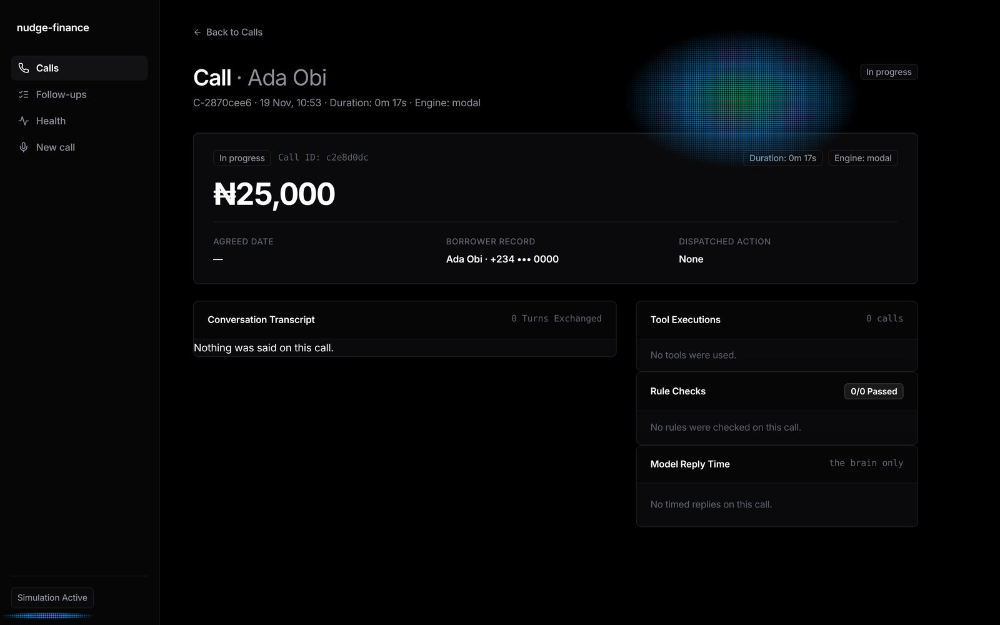
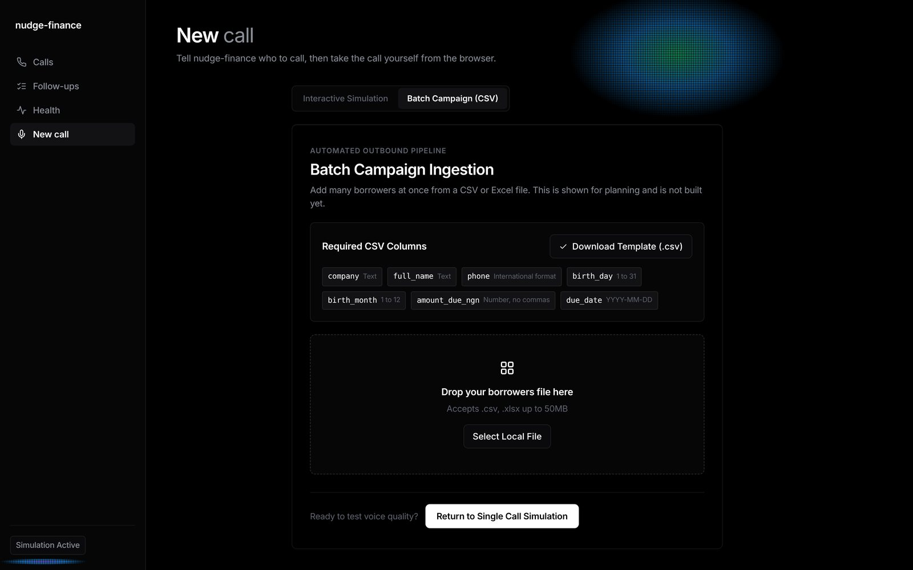
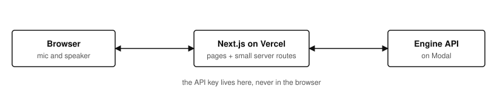

# nudge-finance

**The website for nudge-finance: a voice agent that phones borrowers in Nigeria before their loan is due.**

A company says who to call, then takes the call from the browser and watches it appear in a dashboard: the transcript, the tools the agent used, the rules it checked, and how fast the model answered. The agent itself lives in [`nudge-engine`](https://github.com/aidyai/nudge-engine); this site only talks to that engine's API.

Everything runs on a fake lender and made-up borrowers. No real money, no real customers, no real phone calls.



## Why it exists

Late repayment is expensive for lenders, a text message is easy to ignore, and a call centre is costly and uneven. A calm call a few days **before** the due date, from an agent that checks it has the right person first, never invents an amount, and saves only what the borrower clearly agrees to, is the cheapest place to prevent a late payment. The engine repo explains the problem and the safety rules in full. This site is how you see it work.

## A call, step by step

**1. Say who to call.** Pick a quick pre-fill or type the company, the borrower, their birthday and the loan.



**2. Check, then start.** The review shows exactly what Idara will open with. She asks for the birthday day and month before she says any amount.



**3. Take the call.** Allow the microphone and talk. There is nothing to press: she hears when you stop. Four pills move with her voice and yours. Tap them to interrupt.



**4. Read it back.** Every call lands on the dashboard, and each one has its own page.



**Many borrowers at once** is shown, not built. The Batch tab lists the CSV columns it will need and offers a template to download.



## Pages

| Page | What it does |
|---|---|
| `/` Calls | Every call the agent has made, with totals and filters. Reads the database. |
| `/calls/<id>` | One call: transcript, tool calls, rule checks and model reply times. |
| `/demo` New call | The steps above. Needs the engine. |
| `/follow-ups`, `/health` | Placeholders. |

On a phone the menu is one icon that opens a popup. On a desktop it is a sidebar.

## How it works



The site is a Next.js App Router app in TypeScript. The browser never holds the engine's key:

1. One server route, `src/app/api/[...path]/route.ts`, forwards a short list of paths to the engine and adds the API key on the server. It refuses anything else.
2. To start a call, the page asks the engine for a one-minute signed ticket through that route, then opens a websocket straight to the engine.
3. The microphone is captured at 16 kHz in an audio worklet (`public/pcm-worklet.js`) and streamed as small chunks (`src/lib/use-live-call.ts`). The engine does the listening and turn-taking, and streams its voice back. Tapping the pills stops her voice locally and tells the engine to stop too.

The engine's pipeline is Pipecat with Silero, Deepgram and smart-turn-v3. Details are in the engine repo.

## Run it on your machine

You need Node 22.

```
npm install
cp .env.example .env.local     # set ENGINE_URL and ENGINE_API_KEY
npm run dev
```

Open http://localhost:3000. The Calls pages need only the database behind the engine, so they work when the models are asleep. The New call page needs the models awake.

To talk to the agent:

1. Wake the models on Modal with the `SETUP` cell of the engine's Colab notebook (about 10 minutes).
2. Put the engine's `API_URL` in `ENGINE_URL` and its `API_KEY` in `ENGINE_API_KEY`, in `.env.local`.
3. Open http://localhost:3000/demo, pick a pre-fill, press Start, allow the microphone and talk.
4. When you finish, run the `STOP` cell, or the models keep billing.

Running the engine's evals resets its database and clears the Calls list.

## Checks

```
npm run lint
npm test
npm run typecheck
npm run build
```

## Deploy to Vercel

Push the repo, choose Add New, Project in Vercel, add `ENGINE_URL` and `ENGINE_API_KEY` as environment variables, and deploy. The defaults are right for a Next.js app.

## Not done yet

- **No login.** Anyone with the URL can start a call, and that can start a GPU on Modal. Use Vercel's deployment protection or keep the URL private.
- **Spreadsheet upload** and a scheduler are shown for planning, not built.
- **Follow-ups and Health** are placeholders.
- **The voice does not stream**, so a turn takes 4 to 5 seconds. A streaming voice and backchannels ("mm-hm" must not interrupt) are on the engine's to-do list.
- English only.

MIT licence.
